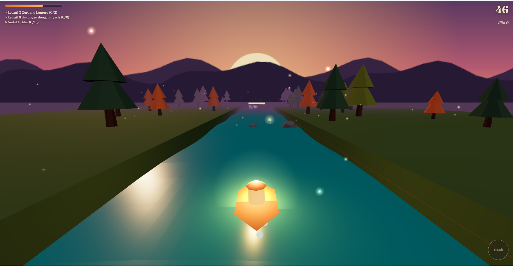
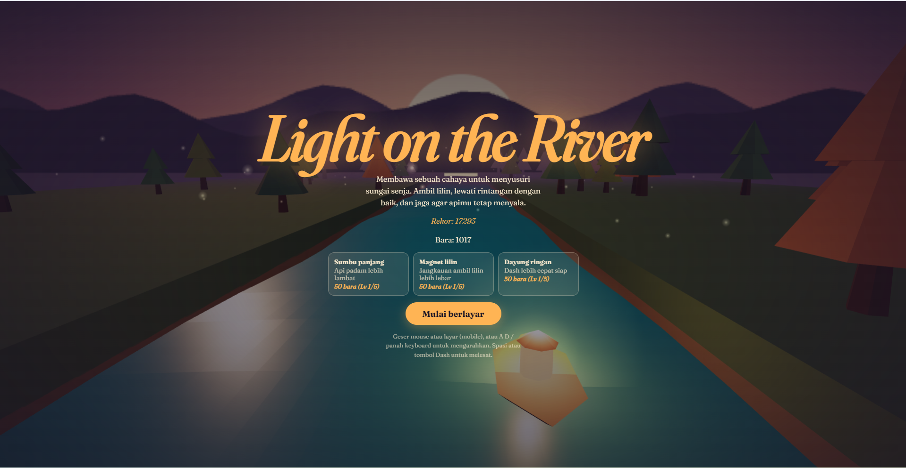
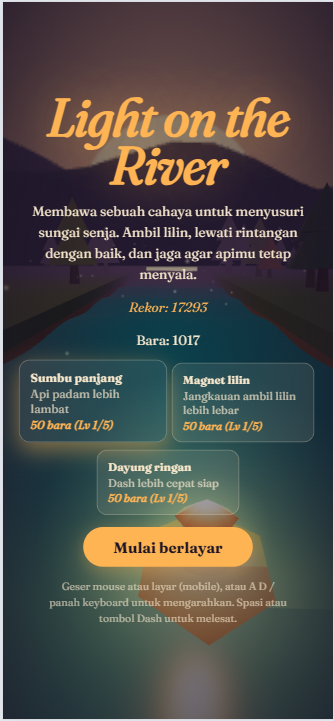

# Light on the River

An arcade river-runner built with **Three.js**. Guide a lantern-lit boat through a low-poly forest, collect candles, avoid hazards, and keep the flame alive for as long as possible.

<p align="center">
  
</p>

<p align="center">
  
  
</p>

> **Development status:** In active development. The game currently runs locally; a public demo has not been deployed.

## About the game

The boat moves continuously down the river. Your task is to steer around obstacles, pick up candles, and make good use of your dash. The lantern is more than decoration: its flame is the run's survival meter. It gradually burns down, so collecting candles and taking calculated risks matters.

Each run combines a distance score, collectible count, combos, and three randomly selected missions. Rewards earned during a run can be spent on upgrades between attempts.

## Current features

- **Low-poly 3D environment** — a winding river, forest, layered mountain silhouettes, animated water, fireflies, and shifting dusk, night, and dawn palettes.
- **Lantern flame system** — the flame gradually decreases and can be replenished by collecting candles, passing lantern gates, and narrowly avoiding hazards.
- **Obstacles and dash** — navigate around rocks, logs, and whirlpools; use a timed dash to move faster and break through eligible obstacles.
- **Score and combos** — build score through pickups and close calls, with a combo multiplier for consecutive rewards.
- **Run-based missions** — three objectives are selected for each run from a pool of candle, gate, near-miss, obstacle-break, and combo challenges.
- **Persistent upgrades** — improve flame duration, candle pickup range, and dash cooldown. Progress is saved in the browser with `localStorage`.
- **Desktop and touch input** — steer with pointer movement or keyboard controls, with an on-screen dash button for touch devices.

## Controls

| Action | Desktop | Touch device |
| --- | --- | --- |
| Steer | Move the mouse, or press `A` / `D` or `←` / `→` | Drag or move your finger across the screen |
| Dash | `Space` or `Left Shift` | Tap the on-screen **Dash** button |
| Pause / resume | `P` or `Esc` | — |
| Toggle sound | `M` | — |

## Run locally

### Requirements

- [Node.js](https://nodejs.org/) and npm
- A browser with WebGL support

### Setup

```bash
git clone https://github.com/mhdridwannst/light-of-river.git
cd light-of-river
npm install
npm run dev
```

Open the local URL printed by Vite in your terminal. If the default port is already in use, Vite may select another available port.

### Production build

```bash
npm run build
npm run preview
```

The production files are generated in `dist/`. They are build output, not source files, and do not need to be committed to the repository.

## Built with

- [Three.js](https://threejs.org/) — 3D rendering and scene management
- [Vite](https://vite.dev/) — local development server and production build
- JavaScript ES modules — game logic and application structure
- WebGL — browser-based rendering
- `localStorage` — local save data for records, embers, and upgrades

## Project structure

```text
src/
├── core/          # Input, event bus, sound, and local save storage
├── effects/       # Particle effects
├── entities/      # Boat and game entities
├── systems/       # Run rules, spawning, missions, and progression
├── ui/            # HUD and menu / upgrade shop
├── world/         # River, forest, lighting, and environment
├── config.js      # Gameplay values and upgrade definitions
├── Game.js        # Main game composition and animation loop
├── gfx.js         # Shared graphics helpers
└── main.js        # Application entry point
```

## Development notes

This repository is a work in progress. Gameplay tuning, visual polish, responsive behaviour, and browser testing may change as development continues. Save data is currently stored in the browser where the game is played; it is not synced between devices.

The in-game interface is currently written in Indonesian.

---

Made as an ongoing Three.js game project by [@mhdridwannst](https://github.com/mhdridwannst).
